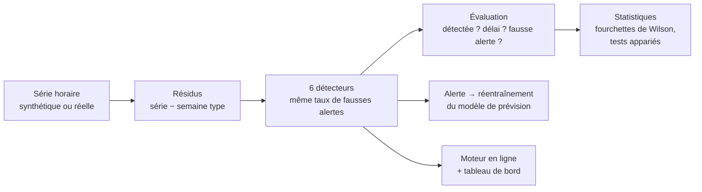
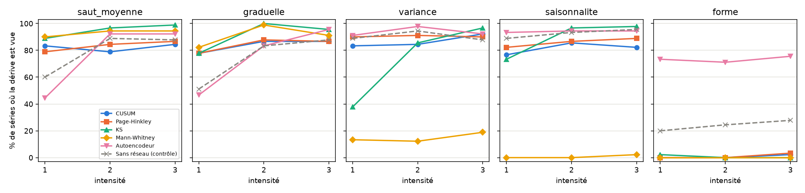
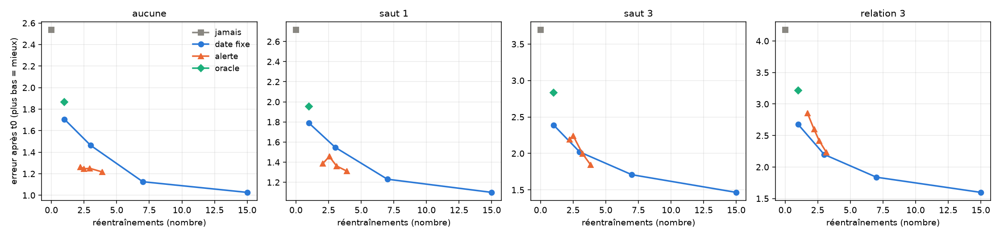

<div align="center">

# ⚡ Détection de dérive conceptuelle sur des flux énergétiques

### Comment savoir qu'un modèle de prévision est devenu périmé — vite, et sans fausses alertes ?


**6 détecteurs · 5 types de dérive · 1 440 séries synthétiques · données réelles ETT · réentraînement · tableau de bord en direct**

</div>

---

Ce projet compare **6 détecteurs de dérive** (CUSUM, Page-Hinkley, test KS, test de Mann-Whitney,
autoencodeur et un contrôle sans réseau) sur des séries **synthétiques**, puis sur de **vraies données**
de charge électrique, et mesure **l'effet d'un réentraînement déclenché par la dérive**.
Tout est construit à la main et testé : générateur, détecteurs, calibration, statistiques, moteur en ligne.

## 🔎 En un coup d'œil

- 🥇 **Aucun détecteur ne gagne partout.** CUSUM et Page-Hinkley sont les plus rapides sur un changement de niveau ; KS est le plus fiable ; Mann-Whitney est aveugle à tout ce qui n'est pas le niveau.
- 🧠 **Le réseau de neurones n'apporte quelque chose que sur un seul type de dérive** (la « forme ») : 71 % contre 24 % pour le contrôle sans réseau en synthétique, 48 % contre 11 % sur données réelles.
- 🌍 **Le passage au réel est brutal** : il faut des seuils 10 fois plus prudents, et la variance ou la saisonnalité deviennent presque invisibles pour les tests statistiques.
- 🔁 **Réentraîner sur alerte bat le calendrier à budget égal**, sauf quand la relation entre les entrées et la cible change.

## 🎯 Le problème en trois phrases

- Les données d'un compteur ou d'un transformateur changent avec le temps (saison, panne, nouvelle habitude) : c'est la **dérive conceptuelle**.
- Un modèle entraîné une fois devient alors **moins précis** sans que personne ne s'en aperçoive.
- Il faut donc un détecteur qui **alerte au bon moment**, sans multiplier les fausses alertes.

## 🔬 Méthodes



| Méthode | Ce qu'elle surveille | Fichier |
|---|---|---|
| CUSUM, Page-Hinkley | La **moyenne** : une dérive lente ou un saut | `src/detecteurs_stat.py` |
| Test KS (Kolmogorov-Smirnov) | **Toute la distribution** d'une fenêtre de 168 h contre la référence | `src/detecteurs_stat.py` |
| Test de Mann-Whitney | Le **niveau** (les rangs) d'une fenêtre contre la référence | `src/detecteurs_stat.py` |
| Autoencodeur (scikit-learn, 8 neurones) | La **structure** : ce que 24 h « normales » ont en commun | `src/detecteur_reseau.py` |
| Contrôle sans réseau | La même idée sans réseau (valeur² lissée) : sert à **prouver** que le réseau apporte quelque chose | `src/detecteur_reseau.py` |

Règles communes, pour une comparaison qui n'est pas truquée :

- Tous travaillent sur des **résidus** (la série moins son profil de semaine type, appris sur 4 semaines).
- Tous sont **calibrés au même taux de fausses alertes** sur des séries calmes, jamais sur les séries de test.
- Tous voient **exactement les mêmes séries**, ce qui permet des tests appariés (test de signe, Wilcoxon).
- Aucun ne voit le futur : le moteur en ligne rejoue la série point par point, et `tests/test_streaming.py` vérifie qu'il donne **exactement les mêmes alertes** que le calcul par lots.

Le protocole complet (règles de notation, périodes, calibration, versions 1 à 5) est dans [`docs/protocole.md`](docs/protocole.md).

## 🏆 Résultats chiffrés

### 1. Synthétique

1 440 séries : 5 dérives × 3 intensités × 3 niveaux de bruit × 30 séries, plus 90 séries calmes.
Taux de détection à l'intensité 2 (90 séries par case) :

| Dérive | CUSUM | Page-Hinkley | KS | Mann-Whitney | Autoencodeur | Contrôle |
|---|---:|---:|---:|---:|---:|---:|
| Saut de moyenne | 79 % | 84 % | **97 %** | 94 % | 92 % | 89 % |
| Dérive graduelle | 87 % | 88 % | **100 %** | 99 % | 83 % | 83 % |
| Variance | 84 % | 91 % | 86 % | 12 % | **98 %** | 94 % |
| Saisonnalité | 86 % | 87 % | **97 %** | 0 % | 94 % | 93 % |
| **Forme** (perte de mémoire du bruit) | 0 % | 0 % | 0 % | 0 % | **71 %** | 24 % |

<div align="center">

</div>

- **Aucun détecteur ne gagne partout.** Mann-Whitney ne voit que le niveau (0 % sur la saisonnalité).
- **Vitesse contre fiabilité** : sur un saut, CUSUM alerte en 12 h (médiane) contre 60 h pour KS, mais 60 % des séries calmes lui arrachent au moins une fausse alerte sur 2 016 h, contre 22 % pour KS.
- **L'autoencodeur n'est meilleur que le contrôle que sur la forme** : 134 séries vues par lui seul contre 1 (test de signe, p < 0,001). Ce qu'il détecte est la **perte de mémoire du bruit**, pas les queues lourdes : 75 % contre 0 % sur du bruit blanc gaussien (`notebooks/verifier_forme.py`).
- **Sur une petite dérive noyée dans le bruit, le réseau décroche** : saut d'intensité 1 avec bruit fort, 10 % pour l'autoencodeur contre 87 % pour Mann-Whitney.

### 2. Données réelles

Jeu ETT, transformateur ETTh1. Seuils réglés sur le **passé**, méthodes jugées sur le **futur**, dérives injectées
à un instant connu. Taux de détection (intensités 2, 4 et 6 regroupées, 27 fenêtres par cas) :

| Dérive | CUSUM | Page-Hinkley | KS | Mann-Whitney | Autoencodeur | Contrôle |
|---|---:|---:|---:|---:|---:|---:|
| Saut de moyenne | 81 % | **93 %** | 81 % | 78 % | 54 % | 72 % |
| Dérive graduelle | 75 % | **89 %** | 78 % | 77 % | 54 % | 67 % |
| Variance | 10 % | 5 % | 2 % | 4 % | 51 % | **60 %** |
| Saisonnalité | 7 % | 4 % | 1 % | 6 % | **40 %** | 38 % |
| Forme | 11 % | 11 % | 22 % | 19 % | **48 %** | 11 % |

- **Les seuils réglés en synthétique ne marchent pas** : en réel il faut des seuils bien plus hauts (CUSUM : h = 200 au lieu de 20 ; KS : p = 10⁻²⁰ au lieu de 10⁻⁵).
- **Page-Hinkley est le meilleur sur les changements de niveau**, avec seulement 4 % de fenêtres calmes en fausse alerte.
- **L'avantage du réseau sur la forme se retrouve** : 48 % contre 11 % (11 séries contre 1, p = 0,006).
- **La calibration voyage mal** : le réseau alerte à tort sur 44 % des fenêtres calmes du futur, contre 13 % sur les fenêtres du passé qui ont servi au réglage.

### 3. Réentraînement

Un modèle linéaire prévoit la température de l'huile à partir des charges (18 fenêtres, ETTh1 et ETTh2).
Erreur après la dérive, en multiples de l'erreur normale :

| Stratégie | Sans injection | Saut 3 | Relation 3 | Réentraînements |
|---|---:|---:|---:|---:|
| Jamais | 2,54 | 3,69 | 4,18 | 0 |
| Tous les 28 jours | 1,46 | 2,02 | 2,20 | 3 |
| Sur alerte (CUSUM, h = 50) | 1,25 | 2,00 | 2,42 | environ 3 |
| Tous les 14 jours | 1,13 | 1,71 | 1,84 | 7 |
| Tous les 7 jours | **1,03** | **1,47** | **1,60** | 15 |

<div align="center">

</div>

- **Ne jamais réentraîner est la pire stratégie** : l'erreur est 2,5 à 4,2 fois l'erreur normale.
- **À budget égal (environ 3 réentraînements), réentraîner sur alerte fait un peu mieux qu'à date fixe** : −0,21 [−0,36 ; −0,09] en l'absence d'injection, sauf quand la **relation** entre entrées et cible change : +0,22 [+0,01 ; +0,43] (intervalles bootstrap à 95 %).
- **Réentraîner souvent bat tout**, tant que réentraîner ne coûte rien.

## 📺 Démo en direct

Le moteur en ligne (`src/streaming.py`) reçoit la série **heure par heure**, comme en production :
il apprend la semaine type, fixe sa référence, entraîne le réseau, puis surveille.

```text
$ python notebooks/demo_streaming.py
Série synthétique : 3360 points, dérive 'saut_moyenne' injectée à t = 1680
t =  672 : profil appris
t = 1008 : référence terminée, réseau entraîné
t = 1344 : validation terminée : la surveillance commence
t = 1704 : ALERTE CUSUM (niveau)  (délai 24 h après la dérive)
t = 1758 : ALERTE Autoencodeur (structure)  (délai 78 h après la dérive)
t = 1764 : ALERTE Contrôle sans réseau  (délai 84 h après la dérive)
```

Le **tableau de bord Streamlit** (`dashboard.py`) montre la même chose en animation : choix de la source
(synthétique ou réelle), du type et de l'intensité de la dérive, courbes des scores et des seuils.

## 🚀 Reproduire

```bash
git clone https://github.com/mounabensmida/derive-projet.git
cd derive-projet
make install       # bibliothèques
make data          # données réelles ETT (déjà présentes dans data/ : rien à faire)
make test          # 33 tests
make demo          # démo en terminal
make run           # tableau de bord : http://localhost:8501
make reproduire    # TOUT refaire (tests + benchmarks + tableaux), environ 15 à 30 min
```

Avec Docker : `docker compose up`, puis ouvrir http://localhost:8501.

**Sous Windows sans `make`**, les mêmes étapes une par une :

```bash
python -m pip install -r requirements.txt
python -m pytest -q
python notebooks/demo_streaming.py
streamlit run dashboard.py
```

Pour refaire les benchmarks : `python notebooks/bench_semaine4.py 30 2`, `python notebooks/bench_semaine5_detection.py`
et `python notebooks/bench_semaine5_reentrainement.py`, puis les trois scripts `notebooks/analyse_*.py`.

Utiliser un détecteur dans votre propre code :

```python
from src.generateur import generer_serie
from src.evaluation import evaluer
from src.residus import residus
from src.detecteurs_stat import cusum

serie, t0 = generer_serie(seed=1, type_derive="saut_moyenne", intensite=2.0)
alertes = cusum(residus(serie))
print(evaluer(alertes, t0))   # {'detectee': True, 'delai': ..., 'fausses_alertes': 0}
```

## 📁 Structure

```
src/            code : générateur, résidus, détecteurs, réseau, calibration, statistiques,
                données réelles, injection, réentraînement, moteur en ligne
notebooks/      benchmarks, analyses, démo, figures
tests/          33 tests (dont l'équivalence streaming / calcul par lots)
dashboard.py    tableau de bord Streamlit
data/           jeu ETT (ETTh1.csv, ETTh2.csv)
docs/           protocole d'évaluation (versions 1 à 5)
figures/        figures du rapport
Makefile, Dockerfile, docker-compose.yml   reproduction en une commande
```

## 🗓️ Avancement

- [x] **Semaine 1** — générateur, règle d'évaluation, KS de base, tests
- [x] **Semaine 2** — résidus, CUSUM, Page-Hinkley, KS et Mann-Whitney glissants, calibration, comparaison avec `river`
- [x] **Semaine 3** — détecteurs appris : autoencodeur, LSTM, contrôle sans réseau
- [x] **Semaine 4** — benchmark à grande échelle, fourchettes et tests statistiques
- [x] **Semaine 5** — données réelles ETT, dérives injectées, stratégies de réentraînement
- [ ] **Semaine 6** — moteur en ligne, tableau de bord, Docker ✔ ; rapport et présentation en cours

## ⚠️ Limites

- Données synthétiques puis **un seul jeu réel** ; sur le réel, les dérives sont **injectées**, pas observées.
- Fenêtres réelles qui **se chevauchent** : les fourchettes sont optimistes.
- Calibration sur **15 à 50 séries** seulement.
- **Un seul petit réseau** (8 neurones cachés) ; modèle de prévision **linéaire**.
- **Coût d'un réentraînement non modélisé** : on compte seulement leur nombre.
- La dérive « forme » est **fabriquée** (perte de mémoire du bruit).

## 📚 Données et références

- Jeu **ETT** : Zhou et al., *Informer: Beyond Efficient Transformer for Long Sequence Time-Series Forecasting*, AAAI 2021 ([github.com/zhouhaoyi/ETDataset](https://github.com/zhouhaoyi/ETDataset)). Une copie est incluse dans `data/` pour la reproductibilité ; `python scripts/telecharger_donnees.py` la retélécharge depuis la source. Vérifiez la licence du jeu avant toute redistribution.
- Page (1954), *Continuous inspection schemes* (CUSUM).
- Gama et al. (2014), *A survey on concept drift adaptation*.

---

<div align="center">

Projet réalisé par [@mounabensmida](https://github.com/mounabensmida)

</div>
